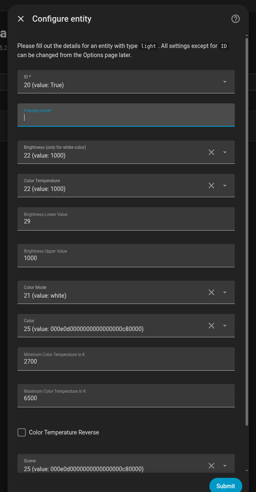

# ha-ledvance-tuya-resync-localkey

pyscript for homeassistant to resync local keys from private tuya API.

This also works for Sylvania devices by changing/uncommenting the keys in `pyscript_modules/tuya/const.py`.

This repository includes

- A script `print_local_keys.py` to print out local keys (and, if the device is reachable on your local network, its
  local IP) for your Ledvance devices (They must be already registered in the Ledvance app), which can be used in the
  [LocalTuya integration](https://github.com/rospogrigio/localtuya) for [Home Assistant](https://www.home-assistant.io/)
- Setup via [Pyscript Integration](https://hacs-pyscript.readthedocs.io/en/latest/) to automatically resync local keys

## To just print out your local keys...

First, install [uv](https://docs.astral.sh/uv/getting-started/installation/) - version 3.10 is confirmed as working.

Then install the dependencies and run the script:

```
uv sync
uv run print_local_keys.py
```

The script reads your Ledvance account credentials from `~/.my-passwords.json`, a JSON list that needs an entry
`{"for": "ledvance", "email": "<email>", "password": "<password>"}`. Never put credentials in the source.

The script also scans your local network (via UDP broadcast) to find each device's local IP address. This only works if
the device is currently online and reachable on the same network segment as the machine running the script - if a device
is offline or on a different network/VLAN, its IP will be reported as not found.

## Resync changed keys automatically in Home Assistant

A reset/re-paired device gets a new local key, and LocalTuya then logs `could not decrypt data: wrong key`.
The [Pyscript](https://hacs-pyscript.readthedocs.io/) app `pyscript/apps/ledvance_resync.py` provides the service
`pyscript.ledvance_resync_keys`: it fetches the keys from the Ledvance cloud, writes changed ones into the LocalTuya
config entry, reloads it and returns `{"updated": [<device names>]}`. Setup is in the app's docstring; call it from
an automation, e.g. when a lamp has been `unavailable` for 15 minutes.

## LocalTuya setup for light bulbs

When adding a light bulb device in the LocalTuya integration, make sure to select the entity type `light` - **not**
`switch` - before configuring the entity. Otherwise, options like color/color temperature control won't be available.



Reference: [How I made tuya-local work with full color controls](https://community.home-assistant.io/t/how-i-made-tuya-local-work-with-full-color-controls/478030/26)

## Credits

Credits for the python Tuya API client go to: https://github.com/rgsilva/homeassistant-positivo
I also extracted the keys/secrets by following his
guide: https://blog.rgsilva.com/reverse-engineering-positivos-smart-home-app/
